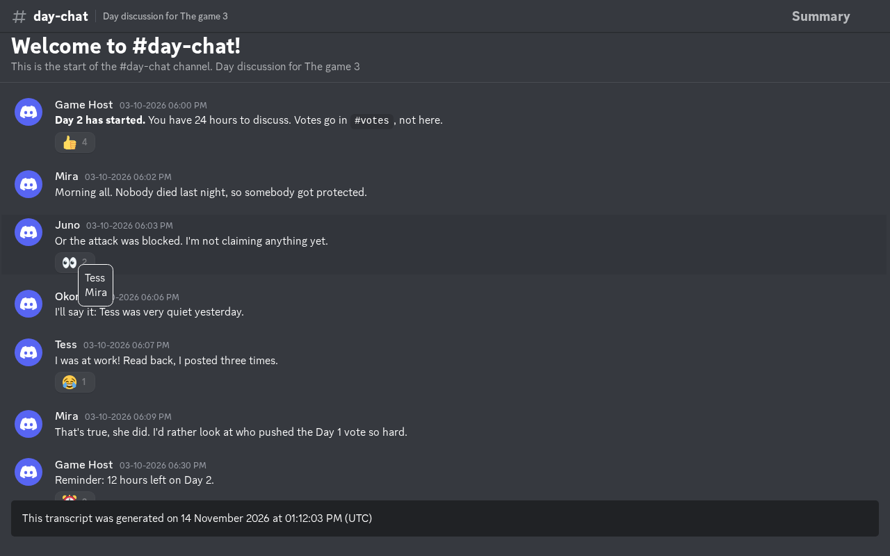

# bwars-helper

A Discord bot for our Blood Wars server. It sets up and tears down game channels, archives finished games as HTML transcripts, and runs a ticket system for support requests.

This repository holds two bots:

- **The main bot** (this folder) runs on a server around the clock.
- **[The roleplay bot](roleplay/)** is a separate Discord app that runs locally, because its replies come from a language model served by [Ollama](https://ollama.com/) on my own machine. Hosting a model next to the main bot would cost far more than the bot itself.

## Commands

| Command | What it does |
| --- | --- |
| `/create_game` | Creates a game’s category, channels and permission overwrites in one step |
| `/delete_game` | Deletes a game category and all its channels |
| `/archive` | Turns a “The game N” category (or one channel in it) into HTML transcripts and locks it to the archive role |
| `/unarchive` | Reverts an archived category to its active state |
| `/setup_tickets` | Posts the ticket panel; its buttons keep working after restarts |
| `/close_ticket` | Stops the ticket creator from sending messages in the ticket |
| `/delete_ticket` | Deletes the current ticket channel |
| `/reload` | Owner only: reloads the cogs and can re-sync slash commands |

Every slash command goes through a sliding-window rate limiter (5 commands per user every 15 seconds) on top of each command’s own cooldown.

## How archives work

Exporting a channel reads its whole history, which is slow and uses a lot of memory and Discord API calls. So transcripts are built one at a time behind a lock, and the bot runs at most three archive jobs at once.

Transcripts are made with [DiscordChatExporterPy](https://github.com/mahtoid/DiscordChatExporterPy). The archives needed to show who reacted to each message, which the library couldn’t do, so I added it upstream in [PR #159](https://github.com/mahtoid/DiscordChatExporterPy/pull/159). Until that is merged, the bot installs a build of the patched library from `chat_exporter-3.1.0-py3-none-any.whl` in this repository.



*A transcript rendered offline from made-up sample data with the bundled wheel, using the same `export_to_file` call the bot makes. Hovering a reaction lists who reacted. The Discord API call that lists reactors was replaced with a stub, so no server or token was involved. To render it yourself: `python docs/sample_transcript.py sample.html` inside the bot’s virtual environment.*

## Run it

Python 3.10 or newer.

```bash
python -m venv venv
source venv/bin/activate
pip install -r requirements.txt
cp .env.example .env
python bot.py
```

| Variable | Purpose |
| --- | --- |
| `DISCORD_BOT_TOKEN` | Bot token |
| `OWNER_ID` | Your Discord user ID, for owner-only commands |
| `ROLE_HOST_PLUS`, `ROLE_HOST` | Role IDs of game hosts |
| `ROLE_JAILED`, `ROLE_SPECTATOR` | Role IDs used inside games |
| `ROLE_ARCHIVE` | Role that can still read archived games |

Fill in every role ID. `utils/config.py` converts each one with `int()`, so a role left empty in `.env` stops the cogs from loading.

The bot needs the **Server Members** intent. It doesn’t read message content.

## Layout

```text
bot.py              startup, the global rate limiter, cog loading and command sync
cogs/               game.py, archive.py, ticket.py, owner.py
utils/              permissions, views, transcript export, rate limiter, config
docs/               sample transcript screenshot and the script that renders it
roleplay/           the separate local roleplay bot (see its README)
```
